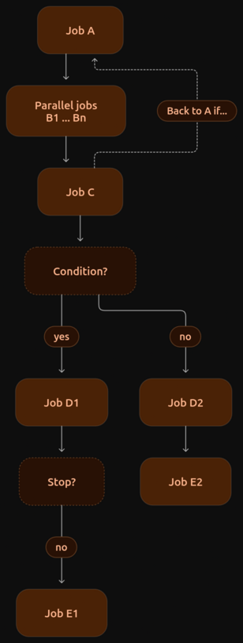

I work in a very specific field (Web Security), however I will try to generalize methods of how I work with LLMs to others, as the methodology should apply the same to all the fields. It's important to mention that this method will NOT make the results "perfect", however, it can significantly help you to get rid of most LLM hallucinations, and it aims to make the LLM strictly follow given steps. Also, it is not something that I would claim as "my original idea". It is used by many, as it is something one naturally comes to if they want to get more trustworthy LLM results.

## Goal 

You've probably been in a situation, when you asked an LLM something and it just blindly responded with false, hallucinated or out-of-date information, failing to use its available tools such as WebSearch. Or you had some list of items the LLM should have gone through and done some work on every one of them and the LLM did not do very deep work on each item, making the result less trustworthy.

Some of you will say that subagents/workflows are the solution. Don't get me wrong, they often are. But there is a subset of tasks where workflows (at least at the current state, Fall 2026) are not enough because they miss a degree of determinism, transparency, and customization that I will try to show you in the following note.

## Chain It

The key goal is to create a custom agent pipeline, a chain of jobs that together brings a more complex, thought-through output. A pipeline, that brings the opportunity to divide the complex task into small subtasks (I call them jobs) which can conditionally branch, repeat or end. The idea is shown in the following graph.

Each of these jobs can have a specific LLM model with specific effort level, specific working directory or sandbox, specific tools or rulesets, specific prompts with variable content, perhaps passed from the preceding jobs. Each of them has a specified output format, which they have to follow and is passed to descendant jobs.

One of the greatest benefits that I've seen in it is that you can design pipelines that closely follow your specific task checklist and you will know the pipeline ensured that the same amount of work has been put into every part of the task and no step was skipped.

A bad design of the pipeline itself however can make the result actually worse and more expensive than a normal "pipelineless" run. One of the things that actually worsens the output is not passing enough information between the jobs, or making the tasks for the atomic jobs too small (or too big). If each job has only a very small amount of work, it still needs to load the context every single time. Small jobs mean inherently more jobs and that means longer and more expensive pipelines. And there is a much bigger area for mistakes in terms of what information to pass between these small jobs. On the other hand, jobs too big miss the benefit of this idea.

## Example

A great simple example to keep it understandable for all readers is when you want an LLM to sketch your roadtrip plan with hotels, restaurants, hiking spots, gas stations and so on.

If you give an instruction to an LLM the simple way, to plan your roadtrip with all stops and requirements, it will give you a pretty good plan, with good dining possibilities, nice hotels etc. As a whole, the plan seems perfect. But as you dive deeper into the plan and begin to fact-check it, you eventually discover holes in the plan that the LLM did not discover. A temporarily closed restaurant, a hotel with no bed for two, too dangerous hiking, bad timing or prices etc.

Now imagine a pipeline solution of the same problem, where each task, like finding a specific hotel, would be delegated to a separate job, then there would be jobs that would fact-check each plan item perhaps from multiple sources, then there would be a job that would skeptically criticize the created plan based on your requirements and conditionally return the pipeline to the beginning with its critique notes.

You would notice that there are logically much fewer holes in the second plan, as there was much more work spent on each of the subtasks.

And that's the idea, that you can use basically for anything. Finding software bugs or vulnerabilities, grammar issues in the text, tracking down citations, researching... If there is much to do, delegate the work!

## Tooling

There exist many solutions that implement this specific idea, perhaps like N8N or other open-source solutions. For my purposes I've created [PipeLLM](https://github.com/ByteMastermind/pipellm), a simple and CLI accessible tool, where pipeline jobs and rules are defined in YAML files (exactly just like CI/CD pipelines, if you see the analogy). Every pipeline idea is easily defined and run, and of course even the pipelines themselves can be easily created by LLMs. Of course, offering a specific solution to a problem in an age of AI this capable is a little bit sarcastic.

## Conclusion

In my opinion, the pipeline design itself is where the value is. Good pipeline design will always mean extraordinary results. Bad design means you will only spend more money on tokens.
